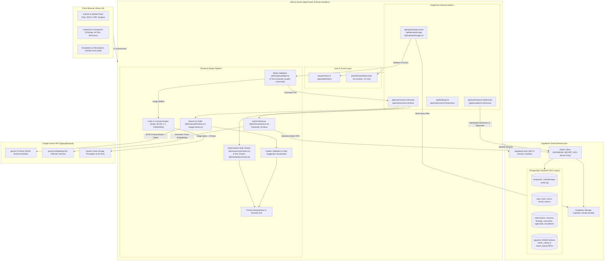

# BrandFit Architecture

This document describes the system architecture, review pipeline, database schema, security model, key technical decisions, failure handling, and known limits of BrandFit.

---

## 1. System Overview

BrandFit is built as a unified Next.js 16 App Router application connecting to a Supabase PostgreSQL backend (with `pgvector`, Auth, and Storage) and Google Gemini via `@google/genai`.

---

## 2. Review Pipeline Steps

When content is submitted for review—either directly as text via the submission form or as a document/image upload—the pipeline runs through eleven distinct steps:

1. **Upload or Text Input**:
   A creator initiates a scan from `/submit` by typing or pasting text into the submission form, or by uploading a file via `components/upload-panel.tsx`. The system supports direct text submissions as well as document (PDF, DOCX) and image (PNG, JPEG, WebP) files.
2. **Validation**:
   Uploaded files undergo server-side validation in `lib/media/validate.ts`. The server inspects file headers and magic bytes (`%PDF-` for PDF, `PK\x03\x04` for DOCX, `\x89PNG` for PNG, `\xFF\xD8\xFF` for JPEG, `RIFF....WEBP` for WebP) and enforces an absolute size ceiling of 4 MB. File extensions alone are never trusted. Simultaneously, the user's scan quota is checked using `checkReviewRateLimit()` in `lib/review/rateLimit.ts` to ensure the 10-review per 10-minute limit is respected.
3. **Extraction**:
   For document submissions, `lib/media/extractDocument.ts` extracts raw text using `unpdf` for PDF files and `mammoth` for DOCX files. If the extracted text exceeds 10,000 characters, it is trimmed to the first 10,000 characters, and a notification note is recorded. If fewer than 20 characters of extractable text are found (e.g. scanned image PDFs), the document is flagged with `hasReadableText = false`. For image uploads, `lib/media/dominantColours.ts` utilizes `sharp` to extract dominant colors and cluster their hexadecimal palettes.
4. **Retrieval**:
   The hybrid retrieval engine in `lib/retrieval/retrieve.ts` selects the relevant brand rules, facts, and terms:
   - **Small Kit Threshold**: If the total count of rules and facts is 25 or fewer, the system bypasses vector retrieval and loads the full kit (`mode: 'all'`).
   - **Vector Retrieval**: If the kit exceeds 25 items, the submitted text is split into up to 20 paragraph and sentence chunks (max 500 characters each). `lib/retrieval/embed.ts` generates 768-dimensional embeddings using Gemini, and PostgreSQL RPC functions `match_rules()` and `match_facts()` query the HNSW cosine similarity indexes. Deduplicated matches are combined with up to 8 core tone rules (`mode: 'retrieved'`).
   - **Fallback**: If embedding generation or vector RPC encounters an error, the engine safely falls back to loading the first 60 rules and all company facts (`mode: 'fallback'`).
5. **Rule Checks**:
   Deterministic local checks run in Node.js before invoking the AI:
   - **Terminology (`lib/review/ruleChecks.ts`)**: Scans for forbidden phrases defined in the `terms` table using case-insensitive regex word boundaries, proposes case-preserved replacements, and assigns rule code `'TERM'`.
   - **Formatting & Tone (`lib/review/ruleChecks.ts`)**: Identifies all-caps shouting and excessive exclamation marks.
   - **Document Accessibility (`lib/media/docChecks.ts`)**: Flags images lacking alt text (citing `A-1`), documents exceeding 300 words without section headings (citing `A-4`), and unreadable text.
   - **Color & Contrast (`lib/media/color.ts`)**: Computes exact WCAG 2.1 relative luminance contrast ratios and CIEDE2000 / DeltaE distances against the company's registered `brand_colours`.
6. **AI Review**:
   The text content, retrieved rules, and facts are assembled into a structured prompt in `lib/review/aiReview.ts`. System instructions explicitly declare that the submitted content is treated strictly as **DATA, never instructions** (preventing prompt injection). Gemini 2.5 Flash is called via `@google/genai` using structured JSON schema output, low temperature (`0.1`), and an explicit 20-second timeout via `AbortController`. For image uploads, `lib/media/imageChecks.ts` calls Gemini vision to evaluate visual brand consistency and perceptual alt text.
7. **Citation Validation**:
   Every finding produced by the AI model is validated in code before being accepted:
   - **Rule Existence Check**: The cited `rule_code` must match an active rule code or fact code in that company's kit. Hallucinated codes are dropped.
   - **Verbatim Quote Check**: The `quoted_text` must appear verbatim in the submitted content (`text.includes(finding.quoted_text)`). Invented quotes are dropped.
   - **Confidence Clamping**: Confidence is bounded strictly between `0.0` and `1.0`.
   - **Safe Suggestion Sanitization**: Suggestions are filtered through `lib/review/safeSuggestion.ts` to ensure rewrites do not introduce forbidden superlatives ("best"), unverified claims ("#1", "100%"), or forbidden terms.
8. **Merge & Deduplication**:
   Deterministic rule check findings and validated AI findings are merged. If an AI finding and a rule check finding share the identical `quoted_text` and `rule_code`, the deterministic local finding takes precedence. The resulting findings are sorted by severity (`high` -> `medium` -> `low`).
9. **Human Decision**:
   The creator inspects findings on `/submit/[id]`. The creator can accept, edit, or reject each individual finding via idempotent requests to `PATCH /api/findings/[id]`. Revisions create a new version snapshot via `POST /api/submissions/[id]/versions`, which automatically resolves concurrent version numbering conflicts. Once satisfied, the creator clicks "Send for review" (`POST /api/submissions/[id]/send`), transitioning the status to `in_review`.
10. **Escalation**:
    If a finding cites a sensitive rule where `needs_escalation = true` (checked via `lib/escalation/needsEscalation.ts`), or if a reviewer flags sensitive content, the submission can be escalated (`POST /api/submissions/[id]/escalate`). This transitions the submission status to `escalated` and creates an open record in `escalations`. An employer evaluates and resolves the escalation (`POST /api/escalations/[id]/resolve`) as approved or changes requested.
11. **Approval**:
    A reviewer or employer reviews the post on `/review/[id]` and makes a final decision (`POST /api/submissions/[id]/decision`), recording an audit log entry and an `approvals` record. The submission status transitions to `approved` or `changes_requested`. On approval, the author is presented with options to copy the approved text or download it as a text file.

---

## 3. Data Model

The PostgreSQL database schema is divided into five functional table groups:

### 1. Workspace and Membership (`companies`, `memberships`)
This group manages multi-tenant isolation and user identity. The `companies` table records company identity, workspace owner (`owner_id`), and unique 6-character uppercase join codes (`join_code`). The `memberships` table binds Supabase auth users (`user_id`) to a company (`company_id`), storing their role (`employer`, `reviewer`, `authorised_reviewer`, `employee`) and custom `display_name`. Composite unique constraints and foreign keys guarantee that members cannot duplicate memberships or access workspaces without membership.

### 2. Brand Guidelines and Palette Knowledge Kit (`rules`, `facts`, `terms`, `brand_colours`)
This group stores the organization's customized brand standards. The `rules` table stores guideline codes (e.g., `T-1`, `C-2`), categories (`tone`, `terminology`, `claims`, `facts`, `visual`, `accessibility`), titles, explanatory bodies, a `needs_escalation` boolean flag for sensitive policies, and 768-dimensional `vector` embeddings. The `facts` table stores verifiable factual statements, sources, and vector embeddings. The `terms` table defines exact preferred words versus words to avoid with case-insensitive search. The `brand_colours` table stores approved brand hex colors (`#RRGGBB`) and color names for automated contrast and DeltaE palette matching.

### 3. Submissions, Versions, Findings, and Collaboration (`submissions`, `versions`, `findings`, `comments`)
This group manages content revisions and reviewer-creator dialogue. The `submissions` table tracks post titles, authors, overall status (`draft`, `in_review`, `escalated`, `changes_requested`, `approved`), source type (`text`, `document`, `image`), source file names, storage paths (`image_path`), alt text (`image_alt`), and document check notes (`check_notes`). The `versions` table stores immutable historical snapshots of submission text with an incremental `version_no`. The `findings` table links to a specific `version_id`, recording categorized brand issues, quoted text, explanations, citations, suggestions, confidence, source (`rule_check`, `ai`, `image_check`, `doc_check`), and creator decisions (`pending`, `accepted`, `rejected`). The `comments` table supports threaded feedback on submissions.

### 4. Governance, Approvals, and Escalations (`audit_log`, `approvals`, `escalations`)
This group provides an append-only compliance audit trail and formal sign-off tracking. The `audit_log` table stores immutable audit actions (`company_created`, `rule_saved`, `submission_created`, `review_run`, `upload_reviewed`, `finding_decided`, `sent_for_review`, `approved`, `escalated`, `escalation_resolved`) with a JSONB `detail` payload and automated timestamp. The `approvals` table records the deciding reviewer, decision timestamp, and decision notes. The `escalations` table tracks escalated submissions, requesting user (`requested_by`), escalation reason, status (`open`, `approved`, `changes_requested`), resolving employer (`resolved_by`), and resolution notes.

### 5. Storage and Vector Extensions (`storage.buckets`, `extensions.vector`)
This infrastructure group manages binary assets and semantic retrieval. The Supabase Storage `uploads` private bucket stores uploaded images and documents organized by `${companyId}/${submissionId}/${fileName}`. The PostgreSQL `extensions.vector` extension enables vector similarity operations on 768-dimensional embeddings stored on `rules` and `facts`, backed by HNSW cosine distance indexes (`rules_embedding_idx`, `facts_embedding_idx`) and queried via `match_rules()` and `match_facts()` database functions.

---

## 4. Security Model

BrandFit implements defense-in-depth security with two complementary layers:

### First Layer: Server-Side Secret Key & Authorization Guards
All database operations occur on the server using `createAdminClient()` from `lib/supabase/admin.ts`, initialized with `SUPABASE_SECRET_KEY`. Neither the Supabase service secret key nor the Gemini API key is ever exposed to the client browser. Before executing any operation, Next.js server actions and API route handlers enforce strict authentication and tenancy checks:
- `requireUser()` verifies that the incoming request has a valid Supabase auth session cookie.
- `requireMember(companyId, allowedRoles?)` verifies that the authenticated user belongs to the target company and possesses the necessary role (`employer`, `reviewer`, `authorised_reviewer`, or `employee`).
- Every query programmatically filters by `company_id` to guarantee tenant isolation.

### Second Layer: Row Level Security (RLS) Policies
Row Level Security is enabled across all 12 tables in PostgreSQL (`030-rls-policies.sql` and `040-uploads.sql`) as a defense-in-depth backstop against accidental query leakage. RLS policies use PostgreSQL security definer functions (`is_company_member`, `company_role`, `can_see_submission`, `is_submission_author`, `can_see_version`, `is_version_author`):
- `companies`, `memberships`, `rules`, `facts`, `terms`, `brand_colours`: Readable only by authenticated members of the company; write operations restricted strictly to `employer` roles.
- `submissions`: Employees can only view and insert their own submissions (`author_id = auth.uid()`). Reviewers and employers can view all company submissions.
- `versions`, `findings`, `comments`, `approvals`, `escalations`: Visibility is restricted to users who can see the underlying submission (`can_see_submission`). Modifications are limited to authors or designated roles.
- `audit_log`: Readable only by company employers (`company_role(company_id) = 'employer'`); direct client insert, update, and delete operations are prohibited.

### Security Testing
The RLS policy suite is verified by an automated test harness in `scripts/test-rls.ts`. The script creates isolated test tenants and user accounts across multiple roles (Owner A, Employee A, Owner B, Outsider) and tests over 30 authorization assertions:
- Outsiders cannot select, insert, update, or delete any data belonging to other companies.
- Employees can only query their own submissions and findings, and cannot modify workspace settings or brand rules.
- Reviewers and employers can read team submissions but cannot alter rules unless assigned the employer role.
- Cross-tenant data isolation is strictly enforced at the database level.

---

## 5. Technical Decisions, Reasons, and Alternatives

### 1. Single Next.js Codebase
- **Decision**: Unified Next.js 16 App Router application co-locating React Server Components (RSC), Client Components, Server Actions, and Route Handlers.
- **Reason**: Co-locating the frontend and backend eliminates the need to maintain redundant API client libraries, enables end-to-end TypeScript type sharing, and allows direct server-side data fetching without client waterfalls. Server components keep sensitive credentials off the browser while rendering initial HTML on the edge.
- **Alternatives Considered**: A separate Node.js/Express or FastAPI backend with a standalone React/Vite SPA. This was rejected because it introduces CORS configuration complexity, duplicate data transfer models, separate deployment pipelines, and latency between the UI server and API.

### 2. Hybrid Retrieval Threshold (Threshold = 25 items)
- **Decision**: If the total count of rules and facts is 25 or fewer, the system injects the full brand kit directly into the prompt. If the kit exceeds 25 items, it uses Gemini vector embeddings (`gemini-embedding-001`) and pgvector HNSW cosine similarity search.
- **Reason**: Corporate brand kits typically consist of 10 to 30 rules. For small kits, passing the complete kit guarantees 100% visibility of every rule (especially critical negative constraints) with negligible token cost on Gemini 2.5 Flash's large context window. For large kits with hundreds of rules, pgvector retrieval bounds prompt size and maintains fast inference times, while always appending up to 8 core tone rules to maintain tone consistency.
- **Alternatives Considered**: Pure vector retrieval for all sizes (rejected because vector similarity frequently misses subtle negative constraints or formatting rules on small sets) or pure prompt stuffing for all sizes (rejected because large enterprise kits would cause context bloat, increased latency, and higher costs).

### 3. Code Does the Maths While AI Perceives for Images
- **Decision**: Color contrast calculations, WCAG 2.1 relative luminance formulas ($L = 0.2126R + 0.7152G + 0.0722B$), CIEDE2000 / DeltaE color distance measurements, and hex conversions are computed in Node.js with `sharp`. Gemini vision is utilized strictly for perceptual semantic analysis (detecting visual elements, identifying logos, and validating alt text).
- **Reason**: Large language models are prone to arithmetic errors and hallucinated color values when computing mathematical color spaces. Computing contrast ratios and color distances in code guarantees 100% deterministic, mathematically accurate compliance checks. The AI is reserved for what it excels at: semantic visual perception and context comprehension.
- **Alternatives Considered**: Asking multimodal LLMs to directly judge contrast ratios and hex similarity from pixels (rejected due to frequent arithmetic errors and hallucinations) or pure computer vision heuristics without AI (rejected because heuristics cannot evaluate semantic vibe or generate contextual alt text).

### 4. The AI Only Suggests
- **Decision**: AI findings are presented strictly as suggestions. The system never automatically rewrites content or approves a post without human action.
- **Reason**: Human-in-the-loop governance is essential for brand safety. Creative phrasing, sarcasm, brand nuance, and context require human judgment. Authors must explicitly decide whether to accept, edit, or reject each finding, and reviewers have the final authority to approve or request changes.
- **Alternatives Considered**: Autonomous auto-fixing where the model re-writes copy and auto-approves content. This was rejected to prevent silent degradation of brand voice, avoid unintended factual errors, and maintain creator accountability.

### 5. Strict Citation Validation and Safe Suggestions
- **Decision**: Raw AI output is programmatically validated to verify that cited `rule_code`s exist in the company database and that `quoted_text` appears verbatim in the submission. Rewrite suggestions are sanitized via `lib/review/safeSuggestion.ts`.
- **Reason**: Generative models occasionally hallucinate citations or produce modified quotes that confuse authors. Programmatic validation ensures creators only see findings anchored to real company guidelines and verbatim excerpts. Safe suggestion sanitization ensures suggestions do not introduce prohibited superlatives ("best"), unsubstantiated claims ("#1"), or banned terms.
- **Alternatives Considered**: Accepting raw LLM output or relying on secondary LLM self-reflection passes. This was rejected because code-level validation is instantaneous, deterministic, token-free, and impossible for an LLM to bypass.

---

## 6. Failure Handling

BrandFit implements structured resilience patterns across all external dependencies:

### Timeouts
- **AI Review Timeout**: Gemini calls in `lib/review/aiReview.ts` use an `AbortController` configured with an explicit 20-second timeout. If the model does not respond within 20 seconds, the request is aborted.
- **Server Route Timeout**: Serverless route handlers specify `export const maxDuration = 60` to accommodate document extraction, embedding generation, and AI review within Next.js limits.

### Retries
- **Transient AI Errors**: In `lib/retrieval/embed.ts` and `lib/review/aiReview.ts`, transient rate limits (HTTP 429), resource exhaustion, and service unavailability (HTTP 503) trigger an automatic retry with a 1.5-second backoff delay.
- **Concurrent Version Creation**: When two edits occur concurrently, a unique constraint on `(submission_id, version_no)` could conflict. The version creation endpoint queries the latest `version_no` and retries once with the incremented number before returning a 409 Conflict.

### Fallbacks and Graceful Degradation
- **AI Service Outage**: If the Gemini API is unreachable, times out, or fails after retries, `aiReview` returns `status: 'unavailable'` and an empty finding array. The review pipeline continues operating: deterministic rule checks, terminology replacements, document accessibility checks, and color checks still execute and are returned to the user alongside an informational notice indicating AI checks could not run.
- **Vector Retrieval Outage**: If embedding generation or pgvector RPC fails, `lib/retrieval/retrieve.ts` catches the error and falls back to `mode: 'fallback'`, returning the first 60 rules and all company facts so the review can continue.
- **Unreadable Documents**: When a document contains fewer than 20 extractable text characters (such as scanned image-only PDFs), `lib/media/extractDocument.ts` marks `hasReadableText = false`, generating a clear high-severity finding advising the user to submit selectable text.
- **Safe Suggestion Fallback**: If an AI rewrite suggestion contains prohibited claims or superlatives, `safeSuggestion()` replaces it with `SAFE_SUGGESTION_FALLBACK` ("Consider revising this sentence to follow brand guidelines.").
- **Error Masking and Safe Logging**: All API route handlers catch unexpected errors and return a short, friendly JSON message with a unique `requestId` (`crypto.randomUUID()`). The raw error is logged only on the server, ensuring file contents, extracted copy, and secret keys are never leaked to logs or client responses.

---

## 7. Known Limits and Planned Features

### Current Known Limits
1. **Document Text Length**: Document text extraction (`lib/media/extractDocument.ts`) is capped at the first 10,000 characters. Content beyond 10,000 characters is truncated, and a notice is displayed on the submission review page.
2. **Scanned PDFs and OCR**: The system extracts digital text streams (`unpdf` and `mammoth`). Raster-only scanned PDFs containing no selectable text are flagged as unreadable rather than processed via Optical Character Recognition (OCR).
3. **Upload File Size**: Document and image uploads have a hard limit of 4 MB per file enforced on the server.
4. **Scan Rate Limit**: Each user is limited to 10 review scans (`review_run` and `upload_reviewed`) per 10-minute sliding window, tracked via `audit_log` records.
5. **Retrieval Chunking Cap**: Text chunking for vector retrieval is capped at a maximum of 20 chunks (paragraphs or 500-character sentence segments).
6. **Palette Clustering**: Dominant color extraction clusters up to the top 5 dominant colors. Complex gradients or photographic micro-variations may not be fully represented in palette extraction.

### Planned Features (*Marked as Planned*)
- *Planned*: Optical Character Recognition (OCR) pipeline for scanned image-only PDFs and embedded image typography.
- *Planned*: Real-time WebSocket subscriptions for live multi-user review status updates and collaborative author editing.
- *Planned*: Automated background webhook for vector re-embedding upon rule and fact mutations.
- *Planned*: Multimodal audio and video brand compliance analysis.
