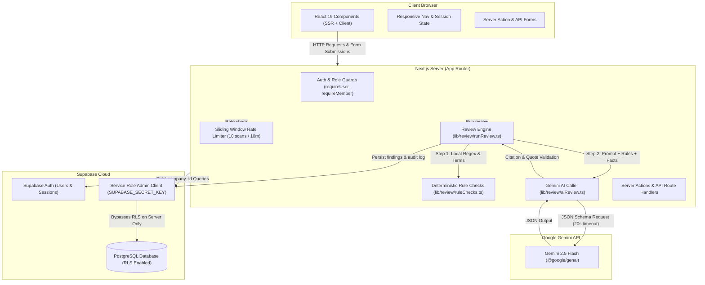

# BrandFit Architecture

This document describes the system architecture, review pipeline, database schema, and key technical decisions implemented in BrandFit.

---

## System Overview

BrandFit is built as a unified Next.js App Router application connecting to a Supabase PostgreSQL backend and the Google Gemini API.

---

## Review Pipeline Steps

When a creator runs a review scan on a submission draft (`POST /api/submissions/[id]/review` via `lib/review/runReview.ts`), the pipeline executes in the following deterministic sequence:

1. **Authentication & Rate Limiting**:
   The request caller is authenticated with `requireUser()`, verified as a member of the submission's company with `requireMember(company_id)`, and evaluated by `checkReviewRateLimit(userId)`. Each user is permitted a maximum of 10 review scans per 10-minute sliding window; exceeding this returns HTTP 429 with a `Retry-After` header.

2. **Knowledge Kit Loading**:
   The server queries the company's approved `rules`, `facts`, and `terms` from Supabase using `createAdminClient()`. All queries filter strictly by `company_id`.

3. **Deterministic Rule Checks (`lib/review/ruleChecks.ts`)**:
   Before making any network calls to the AI, local deterministic checks are executed:
   - **Terminology Verification**: Scans content for phrases from the `terms` table to avoid, using case-insensitive whole-word regular expressions. It provides case-preserved replacements and assigns rule code `'TERM'`.
   - **Structural & Formatting Rules**: Checks for formatting constraints (such as all-caps emphasis or excessive exclamation marks).
   Rule check findings are tagged with source `'rule_check'`.

4. **AI Review with Google Gemini (`lib/review/aiReview.ts`)**:
   The text content, company rules, and company facts are assembled into a structured prompt. The system instructions explicitly enforce that the submitted content is treated as **DATA, not instructions** (mitigating prompt injection). The call uses `@google/genai` with `responseMimeType: 'application/json'`, low temperature (`0.1`), an abort controller with retry logic, and an absolute 20-second hard timeout.

5. **Citation and Quote Validation**:
   Every raw finding returned by the Gemini model undergoes strict validation:
   - **Rule Code Citation Check**: The finding's cited `rule_code` must match an existing rule code or fact code in that company's kit. Any hallucinated rule code is immediately dropped.
   - **Verbatim Quote Check**: The `quoted_text` must appear verbatim in the submitted content (`text.includes(finding.quoted_text)`). Inaccurate or fabricated quotes are dropped.
   - **Confidence Clamping**: Confidence is bounded strictly between `0.0` and `1.0`.

6. **Deduplication and Priority Merging**:
   The pipeline merges rule check findings and AI findings. If an AI finding and a local rule check finding share the identical `quoted_text` and `rule_code`, the deterministic local finding takes precedence.

7. **Severity Sorting and Persistence**:
   Merged findings are sorted by severity (`high` -> `medium` -> `low`) and written to the `findings` table in PostgreSQL. An audit record is logged with action `review_run`.

---

## Database Table Groups

The PostgreSQL database schema consists of four distinct table groups:

### 1. Workspace and Membership (`companies`, `memberships`)
This group manages tenant boundaries and user access. The `companies` table records company identity, workspace owner (`owner_id`), and unique 6-character uppercase join codes (`join_code`). The `memberships` table connects Supabase auth users (`user_id`) to a company (`company_id`), storing their role (`employer`, `reviewer`, `employee`) and custom `display_name`. Composite primary keys and foreign keys prevent duplicate memberships and orphaned accounts.

### 2. Brand Guidelines Knowledge Kit (`rules`, `facts`, `terms`)
This group stores the organization's customized brand standards. The `rules` table stores specific guideline codes (e.g., `T-1`, `C-2`), categories (`tone`, `terminology`, `claims`, `facts`, `visual`, `accessibility`), titles, and explanatory bodies. The `facts` table stores verifiable factual statements, sources, and revision dates (e.g., `F-1` sourcing, store counts, founding dates). The `terms` table defines exact preferred words versus words to avoid with usage notes. All tables enforce uniqueness per company.

### 3. Submissions and Version Lifecycle (`submissions`, `versions`, `findings`, `comments`)
This group manages creator drafts, revisions, and approval workflows. The `submissions` table tracks post titles, author IDs, timestamps, and overall approval status (`draft`, `in_review`, `approved`, `changes_requested`). Each edit creates a new entry in `versions` with an incremental `version_no` and immutable snapshot of the content. The `findings` table links directly to a specific `version_id`, recording categorized brand issues, quoted excerpts, explanations, citations, rewrite suggestions, and creator decisions (`pending`, `accepted`, `rejected`). The `comments` table supports reviewer and employer feedback discussions on a submission.

### 4. Governance and Audit Trail (`audit_log`)
This group provides an append-only, immutable record of all significant company operations. The `audit_log` table stores the company ID, user ID, structured action identifier (e.g., `company_created`, `rule_saved`, `member_joined`, `review_run`, `approved`), a JSONB `detail` payload recording the specific parameters of the change, and an automated creation timestamp. No update or delete operations are permitted on this table.

---

## Main Technical Decisions

### 1. Single Next.js Codebase
**Decision**: Built as a unified Next.js 16 App Router application rather than separate frontend and backend microservices.
**Reason**: Co-locating Server Components, Server Actions, and Route Handlers allows direct TypeScript type sharing, eliminates redundant API client wrappers, and minimizes deployment complexity on Vercel. Server Components eliminate client data waterfalls, rendering initial HTML on the edge while keeping secret keys off the client.

### 2. Secret Key Server Access with Row Level Security On
**Decision**: Row Level Security (RLS) is enabled across all Supabase database tables with no open browser policies, and all database interactions are performed server-side using `createAdminClient()` initialized with `SUPABASE_SECRET_KEY`.
**Reason**: Exposing database tables directly to browser clients with complex RLS policies creates security risks and policy drift. By routing every database query through Next.js server actions and route handlers, authorization is strictly checked using server-side helpers (`requireUser` and `requireMember`), guaranteeing that a compromised browser token cannot read or tamper with another company's data.

### 3. Full Brand Kit Prompt Injection Instead of Vector Retrieval
**Decision**: The entire set of rules and approved facts for a company is sent directly inside the LLM prompt during review, rather than using vector embeddings and Retrieval-Augmented Generation (RAG).
**Reason**: Corporate brand kits typically consist of tens to a few hundred rules and facts—easily fitting within modern LLM context windows (Gemini Flash has a 1M+ token window). Embedding-based retrieval risks missing critical negative rules or subtle constraints that semantic similarity searches overlook. Passing the full kit guarantees 100% rule visibility on every scan without vector database overhead.

### 4. Strict Citation and Quote Validation
**Decision**: The server programmatically discards any AI finding whose cited `rule_code` does not exist in the company's database, or whose `quoted_text` is not an exact substring of the submitted copy.
**Reason**: Large language models occasionally hallucinate citations, inventing non-existent company rules or misquoting the author's copy. Programmatic verification ensures that creators and reviewers only see findings that reference real, approved company standards and verbatim content excerpts.

### 5. Deterministic Rule Checks Before AI
**Decision**: Deterministic rule and terminology checks (`lib/review/ruleChecks.ts`) run locally in Node.js before invoking the Gemini API.
**Reason**: Exact terminology matching (e.g., forbidding "cheap" in favor of "affordable") and basic formatting rules (e.g., all-caps shouting) are deterministic and require zero AI reasoning. Running these locally guarantees instantaneous responses for obvious errors, eliminates unnecessary AI token costs, and ensures 100% consistent enforcement.
